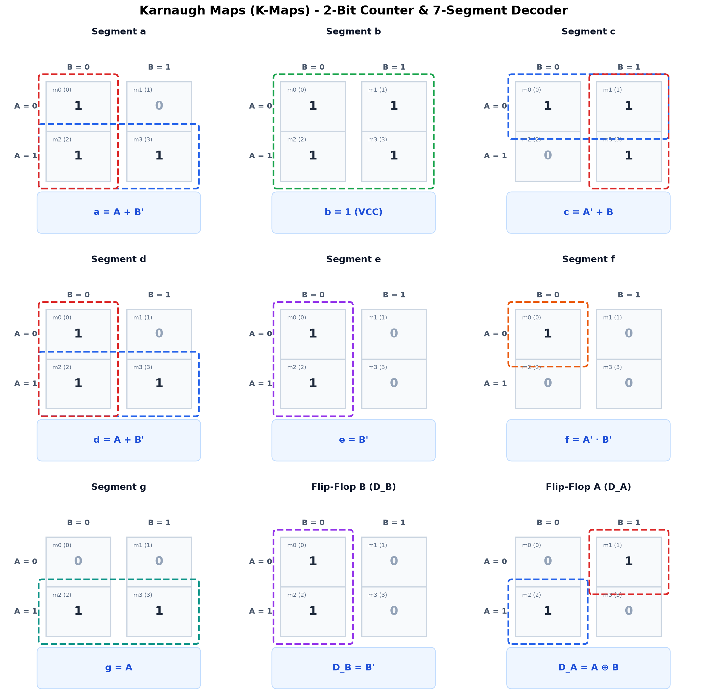

# Karnaugh Maps (K-Maps) Derivations

This document presents the complete 2-variable Karnaugh Maps (K-Maps) used to derive the simplified Boolean expressions for the **2-Bit D Flip-Flop Counter** and the **Common Cathode 7-Segment Display Decoder** (Digits 0, 1, 2, 3) from the **ELECTROX '26** Hackathon.

<p align="center">
  
  <br>
  <em>Figure: Complete 2-variable Karnaugh Maps with grouping loops for all segments and flip-flops.</em>
</p>

---

## 1. 2-Variable K-Map Structure & Cell Mapping

For a 2-variable system with inputs $A$ (MSB) and $B$ (LSB):
- **Rows**: Represent $A$ ($A=0$ and $A=1$)
- **Columns**: Represent $B$ ($B=0$ and $B=1$)
- **Decimal equivalent states**:
  - Cell $(A=0, B=0) \rightarrow \mathbf{m_0}$ (Decimal `0`)
  - Cell $(A=0, B=1) \rightarrow \mathbf{m_1}$ (Decimal `1`)
  - Cell $(A=1, B=0) \rightarrow \mathbf{m_2}$ (Decimal `2`)
  - Cell $(A=1, B=1) \rightarrow \mathbf{m_3}$ (Decimal `3`)

```
          B = 0      B = 1
       +----------+----------+
 A = 0 |  m0 (0)  |  m1 (1)  |
       +----------+----------+
 A = 1 |  m2 (2)  |  m3 (3)  |
       +----------+----------+
```

---

## 2. 7-Segment Display Truth Table (Digits 0 to 3)

On a Common Cathode display, a segment illuminates when driven with logic **1** (+5V):

| Digit | $A$ (MSB) | $B$ (LSB) | Minterm | $a$ | $b$ | $c$ | $d$ | $e$ | $f$ | $g$ |
|:-----:|:---------:|:---------:|:-------:|:---:|:---:|:---:|:---:|:---:|:---:|:---:|
| **0** | 0 | 0 | $m_0$ | 1 | 1 | 1 | 1 | 1 | 1 | 0 |
| **1** | 0 | 1 | $m_1$ | 0 | 1 | 1 | 0 | 0 | 0 | 0 |
| **2** | 1 | 0 | $m_2$ | 1 | 1 | 0 | 1 | 1 | 0 | 1 |
| **3** | 1 | 1 | $m_3$ | 1 | 1 | 1 | 1 | 0 | 0 | 1 |

---

## 3. Individual Segment K-Maps & Equations

### 🔹 Segment $a$
- **Minterms**: $\sum m(0, 2, 3)$
- **K-Map**:

```
          B = 0    B = 1
       +--------+--------+
 A = 0 |   1    |   0    |
       +--------+--------+
 A = 1 |   1    |   1    |
       +--------+--------+
```

- **Grouping**:
  - Group 1 (Row 1, cells $m_2, m_3$): covers $A$
  - Group 2 (Column 0, cells $m_0, m_2$): covers $\overline{B}$
- **Simplified Equation**: 
  $$\mathbf{a = A + \overline{B}}$$
- **Hardware**: 1 OR gate (IC 7432) with inputs $A$ and $\overline{B}$.

---

### 🔹 Segment $b$
- **Minterms**: $\sum m(0, 1, 2, 3)$
- **K-Map**:

```
          B = 0    B = 1
       +--------+--------+
 A = 0 |   1    |   1    |
       +--------+--------+
 A = 1 |   1    |   1    |
       +--------+--------+
```

- **Grouping**: Entire 4-cell group is 1.
- **Simplified Equation**: 
  $$\mathbf{b = 1 \ (V_{CC})}$$
- **Hardware**: Direct wire to $+5\text{V}$ ($V_{CC}$) through a $330\,\Omega$ resistor.

---

### 🔹 Segment $c$
- **Minterms**: $\sum m(0, 1, 3)$
- **K-Map**:

```
          B = 0    B = 1
       +--------+--------+
 A = 0 |   1    |   1    |
       +--------+--------+
 A = 1 |   0    |   1    |
       +--------+--------+
```

- **Grouping**:
  - Group 1 (Row 0, cells $m_0, m_1$): covers $\overline{A}$
  - Group 2 (Column 1, cells $m_1, m_3$): covers $B$
- **Simplified Equation**: 
  $$\mathbf{c = \overline{A} + B}$$
- **Hardware**: 1 OR gate (IC 7432) with inputs $\overline{A}$ and $B$.

---

### 🔹 Segment $d$
- **Minterms**: $\sum m(0, 2, 3)$
- **K-Map**:

```
          B = 0    B = 1
       +--------+--------+
 A = 0 |   1    |   0    |
       +--------+--------+
 A = 1 |   1    |   1    |
       +--------+--------+
```

- **Grouping**: Identical to Segment $a$.
- **Simplified Equation**: 
  $$\mathbf{d = A + \overline{B}}$$
- **Hardware**: Can share the output of Segment $a$'s gate or use another OR gate.

---

### 🔹 Segment $e$
- **Minterms**: $\sum m(0, 2)$
- **K-Map**:

```
          B = 0    B = 1
       +--------+--------+
 A = 0 |   1    |   0    |
       +--------+--------+
 A = 1 |   1    |   0    |
       +--------+--------+
```

- **Grouping**:
  - Column 0 (cells $m_0, m_2$): covers $\overline{B}$
- **Simplified Equation**: 
  $$\mathbf{e = \overline{B}}$$
- **Hardware**: Direct connection from inverted LSB ($\overline{B}$, from 7404 NOT gate or flip-flop $\overline{Q_B}$).

---

### 🔹 Segment $f$
- **Minterms**: $\sum m(0)$
- **K-Map**:

```
          B = 0    B = 1
       +--------+--------+
 A = 0 |   1    |   0    |
       +--------+--------+
 A = 1 |   0    |   0    |
       +--------+--------+
```

- **Grouping**:
  - Single isolated cell $m_0$ ($A=0, B=0$)
- **Simplified Equation**: 
  $$\mathbf{f = \overline{A} \cdot \overline{B}}$$
- **Hardware**: 1 AND gate (IC 7408) with inputs $\overline{A}$ and $\overline{B}$ (or NOR of $A+B$).

---

### 🔹 Segment $g$
- **Minterms**: $\sum m(2, 3)$
- **K-Map**:

```
          B = 0    B = 1
       +--------+--------+
 A = 0 |   0    |   0    |
       +--------+--------+
 A = 1 |   1    |   1    |
       +--------+--------+
```

- **Grouping**:
  - Row 1 (cells $m_2, m_3$): covers $A$
- **Simplified Equation**: 
  $$\mathbf{g = A}$$
- **Hardware**: Direct wire from flip-flop MSB output ($Q_A$).

---

## 4. D Flip-Flop Next-State K-Maps

The counter states are:
$00 \rightarrow 01 \rightarrow 10 \rightarrow 11 \rightarrow 00$

### 🔹 LSB Flip-Flop Input ($D_B$)
- $B_{next} = 1$ when $(A, B) = (0, 0)$ or $(1, 0)$
- **K-Map**:

```
          B = 0    B = 1
       +--------+--------+
 A = 0 |   1    |   0    |
       +--------+--------+
 A = 1 |   1    |   0    |
       +--------+--------+
```

- **Result**:
  $$\mathbf{D_B = \overline{B}}$$
- Inverted output $\overline{Q_B}$ is fed directly back into input $D_B$.

---

### 🔹 MSB Flip-Flop Input ($D_A$)
- $A_{next} = 1$ when $(A, B) = (0, 1)$ or $(1, 0)$
- **K-Map**:

```
          B = 0    B = 1
       +--------+--------+
 A = 0 |   0    |   1    |
       +--------+--------+
 A = 1 |   1    |   0    |
       +--------+--------+
```

- **Result**:
  $$\mathbf{D_A = \overline{A}B + A\overline{B} = A \oplus B}$$
- $D_A$ toggles when $B = 1$, implemented with logic gates or XOR.
