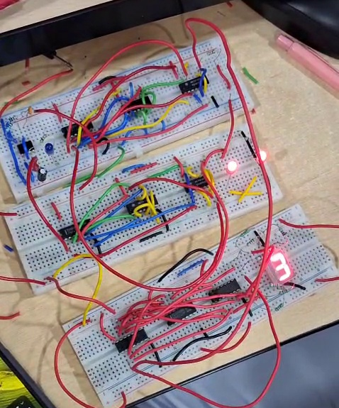
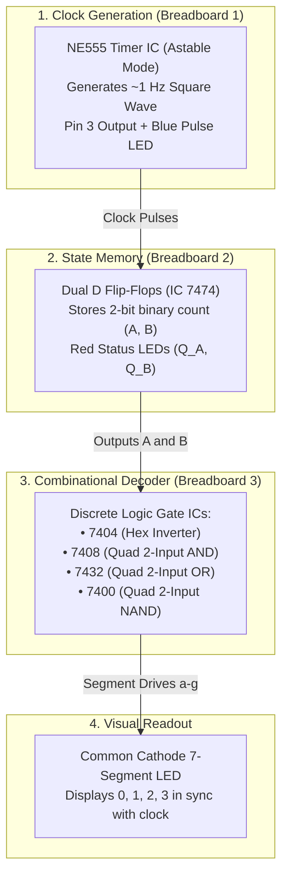

# 2-Bit D Flip-Flop Synchronous Counter with 555 Timer & Discrete 7-Segment Decoder

A hands-on digital electronics project built and demonstrated during the **ELECTROX '26** Hackathon at Bannari Amman Institute of Technology (BIT).

<p align="center">
  
  <br>
  <em>Figure: The complete 3-breadboard circuit in action — 555 Timer clock generator (top), 2-bit D Flip-Flop state memory with binary status LEDs (middle), and gate-level discrete 7-segment decoder displaying decimal "3" (bottom).</em>
</p>

---

## 📌 Project Overview

This project implements a **2-Bit Binary Up Counter** cycling continuously through four states:
$$\mathbf{00 \ (0) \longrightarrow 01 \ (1) \longrightarrow 10 \ (2) \longrightarrow 11 \ (3) \longrightarrow 00 \ (0)}$$

Instead of using a pre-packaged BCD-to-7-segment decoder IC (such as a 7447), we designed and wired the decoder **from fundamental discrete logic gates (AND, OR, NOT, NAND)** to deeply understand how digital logic translates from truth tables on paper to physical breadboards.

---

## 🚀 System Architecture



---

## 🧩 Components Used (Bill of Materials)

| Component | Quantity | Purpose |
|:----------|:--------:|:--------|
| **NE555 Timer IC** | 1 | Astable clock pulse generator (~1 Hz) |
| **IC 7474** (Dual D Flip-Flop) | 1 | 2-bit synchronous state memory |
| **IC 7404** (Hex Inverter) | 1 | Generates inverted signals $\overline{A}$ and $\overline{B}$ |
| **IC 7408** (Quad 2-Input AND) | 1 | Implements product terms ($f = \overline{A}\cdot\overline{B}$) |
| **IC 7432** (Quad 2-Input OR) | 1 | Implements sum terms ($a = A + \overline{B}$, $c = \overline{A} + B$) |
| **IC 7400** (Quad 2-Input NAND) | 1 | Auxiliary gate logic / feedback |
| **7-Segment Display (Common Cathode)** | 1 | Decimal output visualization (0 to 3) |
| **LEDs (5mm)** | 3 | 1x Blue (Clock pulse indicator), 2x Red (Bit $Q_A$, $Q_B$) |
| **Resistors** | 10+ | $330\,\Omega$ (LED current limiters), $10\,\text{k}\Omega$, $68\,\text{k}\Omega$ (Timing) |
| **Capacitors** | 2 | $10\,\mu\text{F}$ (electrolytic timing), $0.01\,\mu\text{F}$ (ceramic bypass) |
| **Solderless Breadboards** | 3 | Modular construction across sub-circuits |
| **Jumper Wires & Power Supply** | Many | +5V DC regulated power and interconnects |

---

## ⚡ Working Principles

### 1. Clock Generation (NE555 Astable Multivibrator)
The NE555 timer is configured in astable multivibrator mode to continuously produce a clock signal:
$$f \approx \frac{1.44}{(R_1 + 2R_2) \cdot C_1} \approx 1\text{ Hz}$$
- **Pin 3** supplies the square wave clock to the flip-flops and drives an onboard blue LED so we can visually observe the clock edges.

### 2. 2-Bit State Memory (D Flip-Flops)
- **Least Significant Bit ($B$ / $Q_B$)**: Toggles on every clock edge by feeding inverted output $\overline{Q_B}$ back into $D_B$ ($D_B = \overline{B}$).
- **Most Significant Bit ($A$ / $Q_A$)**: Changes state when $B$ is high ($D_A = A \oplus B$).
- Red indicator LEDs are wired to $Q_A$ and $Q_B$ via $330\,\Omega$ resistors to display the raw binary value (`00`, `01`, `10`, `11`).

### 3. Gate-Level 7-Segment Decoder
Instead of using a standard monolithic decoder IC (like 7447), our team designed the decoding logic from scratch using individual logic gates (7404 NOT, 7408 AND, 7432 OR) derived directly from **K-Maps (Karnaugh Maps)**.

---

## 🗺️ Karnaugh Maps (K-Maps) & Boolean Simplification

To drive the 7-segment display for decimal digits `0`, `1`, `2`, and `3`, each segment ($a$ through $g$) was solved using a 2-variable K-Map where $A$ is the MSB and $B$ is the LSB:

<p align="center">
  
  <br>
  <em>Figure: 2-variable Karnaugh Maps with grouping loops for all segments and flip-flops.</em>
</p>

| Segment | Minterms ($\sum m$) | Grouping & Logic | Simplified Equation | Hardware Gate Used |
|:-------:|:-------------------:|:-----------------|:-------------------:|:-------------------|
| **$a$** | $m(0, 2, 3)$ | Row 1 ($A$) + Col 0 ($\overline{B}$) | **$a = A + \overline{B}$** | 1 OR Gate (IC 7432) |
| **$b$** | $m(0, 1, 2, 3)$ | All 4 cells are 1 | **$b = 1$** | Tied to $+5\text{V}$ ($V_{CC}$) |
| **$c$** | $m(0, 1, 3)$ | Row 0 ($\overline{A}$) + Col 1 ($B$) | **$c = \overline{A} + B$** | 1 OR Gate (IC 7432) |
| **$d$** | $m(0, 2, 3)$ | Row 1 ($A$) + Col 0 ($\overline{B}$) | **$d = A + \overline{B}$** | 1 OR Gate (IC 7432) |
| **$e$** | $m(0, 2)$ | Col 0 ($\overline{B}$) | **$e = \overline{B}$** | 1 Inverter / NOT (IC 7404) |
| **$f$** | $m(0)$ | Single cell $m_0$ ($\overline{A}\overline{B}$) | **$f = \overline{A}\cdot\overline{B}$** | 1 AND Gate (IC 7408) |
| **$g$** | $m(2, 3)$ | Row 1 ($A$) | **$g = A$** | Direct wire from MSB ($Q_A$) |
| **$D_B$** | $m(0, 2)$ | LSB toggles each clock | **$D_B = \overline{B}$** | Feedback from $\overline{Q_B}$ |
| **$D_A$** | $m(1, 2)$ | MSB toggles when $B=1$ | **$D_A = A \oplus B$** | XOR / Logic gates |

👉 *For the step-by-step breakdown of each K-map grid, cell coordinates, and grouping loops, see the dedicated guide: [K_MAPS.md](K_MAPS.md).*

---

## 📖 Key Learnings as a First-Year Student

Taking this project from theory into practical hardware was a tremendous learning experience. Some of the most impactful takeaways:

1. **Getting Familiar with Real IC Pinouts**:
   In textbooks, logic gates appear as floating symbols. In reality, every 14-pin IC requires proper power ($V_{CC}$ at pin 14) and ground (GND at pin 7), and keeping track of gate input/output pin numbers taught me how to read datasheets carefully. *(See our quick guide in [docs/PINOUTS.md](docs/PINOUTS.md)).*
2. **Understanding the NE555 Timer**:
   Learning how an external resistor-capacitor (RC) combination controls charging and discharging cycles to set the clock frequency was a great introduction to mixed-signal behavior.
3. **Appreciating Flip-Flops & Clock Edges**:
   Seeing the D flip-flop capture and hold its state precisely on the rising clock edge made sequential logic concepts much more tangible.
4. **The Critical Need for Breadboard Wiring Discipline**:
   With three breadboards connected together, loose jumper wires or noisy rails quickly cause intermittent glitches. Learning to route wires systematically, trim jumpers to size, and maintain common power/ground rails made all the difference between a failing circuit and a working one.
5. **Teamwork & Collaborative Debugging**:
   Hardware hackathons are intense. Working as a team taught us to:
   - Divide the circuit into modular sections (one person on the 555 timer clock, another on the flip-flop logic, another on the 7-segment decoder).
   - Trace faults step-by-step with a multimeter and probe LEDs rather than guessing.
   - Stay patient and support each other through unexpected loose connections.
6. **Embracing Imperfection: The Real Hardware Learning Curve**:
   During our live hackathon demonstration, we have to admit that the output sequence was not 100% correct all the time—we ran into state glitches and transition hiccups along the way. But that discrepancy between ideal theory and messy physical breadboards was where the greatest learning took place. Tracing down loose wires, observing clock sensitivities, and troubleshooting the circuit as a team taught us far more about real engineering than an experiment that worked on the very first try.

---

## 🛠️ Troubleshooting & Practical Tips

- **Floating Inputs**: In TTL logic (74xx series), leaving an input pin unconnected can float HIGH or pick up surrounding electromagnetic noise. Always tie unused gate inputs to a defined state.
- **Current Limiting Resistors**: Never connect LEDs or 7-segment pins directly to +5V or GND without a resistor ($220\,\Omega$ – $330\,\Omega$) to protect both the display and the gate outputs.
- **Common Ground Rail**: Ensure the ground rails of all three breadboards are tied together; without a common ground reference, signals will be erratic.

---

## 📂 Repository Structure

```
2-bit-d-flip-flop-counter/
├── assets/
│   ├── images/
│   │   └── circuit_hero.jpg             # Cropped hardware prototype photo
│   └── schematics/
│       ├── 555_timer_schematic.jpg      # Astable 555 timer circuit diagram
│       ├── counter_and_gate_connections.jpg # IC pin connection schematic
│       ├── 7_segment_boolean_logic.jpg  # Segment equations derivation
│       └── reference_breadboard_layout.png # Organizer breadboard model
├── docs/
│   ├── CIRCUIT_LOGIC.md                 # Truth tables, K-maps, & derivations
│   ├── K_MAPS.md                        # Step-by-step Karnaugh Maps guide
│   └── PINOUTS.md                       # Complete IC pinout reference tables
├── .gitignore                           # Excludes heavy video (.mp4) and temp files
├── circuit_hero.jpg                     # Root copy for direct GitHub rendering
├── k_maps_reference.png                 # Complete K-maps diagram
├── K_MAPS.md                            # Dedicated K-maps derivation document
├── LICENSE                              # MIT License
└── README.md                            # Main project documentation
```

---

## 👥 Team Members

Developed collaboratively during the **ELECTROX '26** Hackathon at Bannari Amman Institute of Technology:

- **Harsh Bohra D**
- **Sanmathi M**
- **Mukesh B A**

*Department of Electronics and Communication Engineering, Bannari Amman Institute of Technology.*

---

## 📜 License

This project is open-source under the [MIT License](LICENSE).
